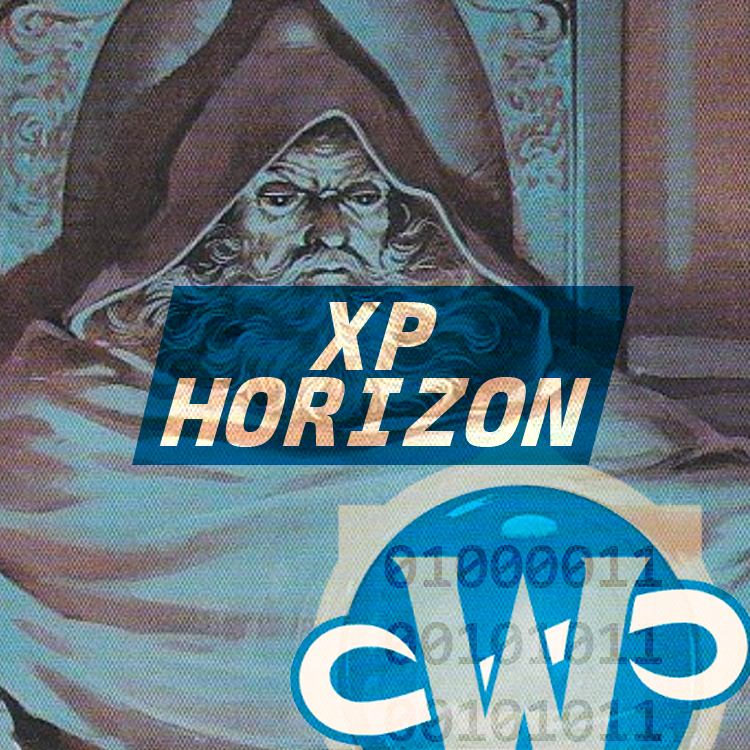
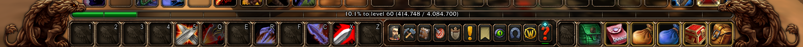
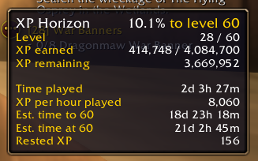

<p align="center">
  
</p>

# XP Horizon

An addon for WoW Forever that shows how far you are from level 60, counting all the XP from level 1 instead of only the current level.

## Usage

Hold **Shift** while hovering your XP bar.

### The bar

The bar switches to your total progress to level 60. It fills in green with Blizzard's own bar art, and the text shows the percentage and your XP out of the total.



### The tooltip

The tooltip shows your percentage to level 60, your level, XP earned and remaining, and rested XP if you have any. It also estimates when you will reach 60: time played, XP per hour played, time left, and total /played at level 60.



Release Shift and the normal bar and tooltip come back.

## Installation

1. Download the latest release and extract the `XpHorizon` folder.
2. Put it in `World of Warcraft\_forever_\Interface\AddOns\`.
3. Restart the game or type `/reload`.

## How the numbers are worked out

- **XP per level.** The addon starts with the original Classic XP table, 4,084,700 XP from level 1 to 60. The game only reports the XP needed for the level a character is currently at, so each time a character is seen at a level, the addon saves that value in `XpHorizonDb` and uses it from then on. If Forever's table differs from Classic's, the totals correct themselves for every level you have played.
- **Time estimate.** Your total XP divided by your total /played gives an average XP per second. The XP still needed is divided by that rate. XP per hour usually rises as you level, so the estimate tends to run long.
- **/played.** The game only lets addons read /played by asking the server, and the reply is always printed in chat. The addon asks once per session, the first time you open the Shift view. Typing `/played` yourself updates the estimate too.

## Limitations

- The level cap is fixed at 60.
- The text is English only.

## Development

Clone the repository into `Interface\AddOns\XpHorizon`. The TOC version reads `@project-version@` in the source. The release packager fills it in, so the addon list shows that text when you run straight from a checkout.

To publish a release, tag the commit and push the tag:

```bash
git tag v1.0.1
git push origin v1.0.1
```

The workflow in `.github/workflows/release.yml` builds the zip and attaches it to a GitHub release. It also uploads to CurseForge and Wago when the TOC has `X-Curse-Project-ID` or `X-Wago-ID` and the `CF_API_TOKEN` (or `CF_API_KEY`) or `WAGO_API_TOKEN` repository secret is set.

## License

[GPL-3.0-or-later](LICENSE)
